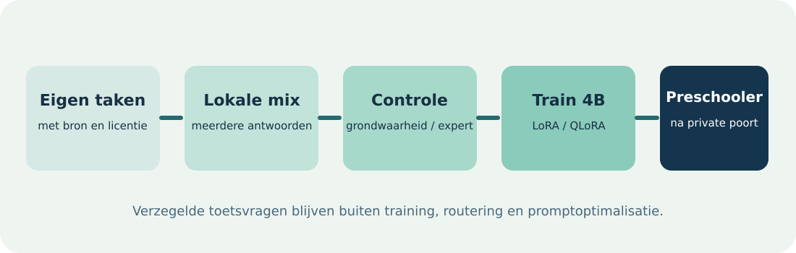

# Preschooler

**Businessconcept voor een eigen 4B-modelfamilie** 
Virtuanalytica · besluitversie 0.1 · 11 oktober 2026

> **Status.** Dit document beschrijft een uitvoerbaar experiment en commerciële hypothese. Er bestaat nog geen getrainde Preschooler-checkpoint, geen gevalideerde Preschooler-omzet en geen bewezen voordeel boven een externe API.

## 1. De kans en de naam

Toddler is vandaag een lerend systeem met afzonderlijke policies, modellen, Teacher, routering en bewijsstromen. Een succesvolle navigatieproef van G4 maakt Toddler geen enkel taalmodel met optimale gewichten. **Preschooler** wordt de naam van een zelfstandige modelfamilie die uit die omgeving kan groeien. De eerste kandidaat heet **Preschooler-4B-v0.1**. Toekomstige groottes volgen dezelfde familienaam, maar krijgen een afzonderlijke modelkaart en toets.

Het verkoopbare resultaat is geen losse score. Het is een lokaal inzetbare, kleine specialist die een eigenaar controleerbaar werk laat uitvoeren: eerst software- en datataken, daarna domeinen die eigen acceptatietoetsen halen. Privacy, herleidbaarheid, voorspelbare inzetbaarheid en acceptatiekosten bepalen de waarde. Een 4B-checkpoint is alleen zinvol als het bij hetzelfde werk sneller of goedkoper is, of een aantoonbare privacy- of beschikbaarheidswinst geeft.

## 2. Product en eerste klant

**Startklant:** kleine software- en datateams met herhaalbare, objectief controleerbare taken en gevoelige broncode of bedrijfsdata. De eerste betaalde proef omvat een debugger- of datareconciliatie-agent in een afgeschermde werkruimte. Een klant accepteert of verwerpt de uitkomst volgens vooraf vastgelegde criteria.

**Twee producten blijven onderscheiden.** Toddler + Teacher + mixture is het samengestelde agentsysteem. Preschooler-4B is één lokaal inzetbaar taalmodel binnen dat systeem. Een verbetering van het team wordt niet aan Preschooler-gewichten toegeschreven zonder vergelijking met dezelfde Toddler-configuratie en de ongetrainde 4B-basis.

**Verdienmodel:** de bestaande Toddler-platformlicenties zijn de commerciële basis: een eigenaarabonnement en een bedrag per gemiddeld actief betaald agentjaar. Preschooler kan daarop als privacygerichte lokale route dienen. De scenario's hieronder tonen het deel van de bestaande platformlicenties dat door Preschooler-agenten bediend zou kunnen worden; zij zijn **geen extra omzet** bovenop het ondernemingsplan voor 2027–2031. Een aparte Preschooler-prijs wordt pas na betaalde pilots getest.

## 3. Eerste training: gecontroleerde assimilatie

De basis is [Qwen3-4B-Instruct-2507](https://huggingface.co/Qwen/Qwen3-4B-Instruct-2507), waarvan de modelkaart 4,0 miljard parameters en Apache-2.0 vermeldt. De eerste training gebruikt LoRA/QLoRA op een tijdelijke kandidaat, met een bevroren basis als controle. Modelarchitecturen en gewichten uit de mixture worden **niet** samengevoegd. De kennisoverdracht loopt via geverifieerde voorbeelden.

1. Stel nieuwe taken op vanuit eigen capability-bronnen. Registreer licentie, taakfamilie, brondatum en canonieke vraaghash.
2. Laat meerdere **lokale** mixture-modellen onafhankelijk antwoorden met vastgelegde modelhash, modellicentie en trainingsrecht op de output, prompt, decodeerprofiel, t/s en energie.
3. Houd alleen antwoorden met objectieve grondwaarheid of afzonderlijke deskundige beoordeling. Een model dat zijn eigen antwoord goedkeurt, is geen onafhankelijk bewijs.
4. Scheid data op bronfamilie en taakidentiteit in train, ontwikkeling en verzegelde eindtoets. Geen toetsvraag, variant of afgeleide terecht in training, routering of promptoptimalisatie.
5. Train de 4B-adapter, vergelijk met dezelfde ongetrainde basis en archiveer iedere poging inclusief mislukte resultaten. Herhaal op verse taken voor retentie en transfer.

Cloudantwoorden, klantdata zonder trainingsrecht en voorbeelden met onduidelijke herkomst zijn uitgesloten van de eerste trainingsset. Het bestaande G4-navigatieresultaat blijft afzonderlijk bewijs voor navigatie; taal- en softwarevaardigheid vergen eigen toetsen.

## 4. Acht leergangen: van Preschooler naar Academic Schooler

**Acht trainingen zijn acht inhoudelijke leergangen, geen acht keer dezelfde toets memoriseren.** De kandidaat doorloopt wiskunde en logica; natuurkunde; scheikunde; softwareontwikkeling; financiële data en signalen; taal, geschiedenis en cultuur; gamedev en interactieve interfaces; en agentplanning met verificatie. Elke leergang scheidt (a) feiten en bronkennis, (b) begrip en transfer naar nieuwe vraagvormen, en (c) aantoonbare vakhandeling. Oefenvragen, bronfamilies en eindtoetsen worden daarvoor afzonderlijk ingedeeld. Voor veiligheid en onzekere beroepsbesluiten blijven domeinspecifieke menselijke controles bestaan.

**4B-fase.** Begin per leergang met 10.000 geselecteerde voorbeelden van gemiddeld 1.536 tokens, twee trainingspasses en een afzonderlijke adapter: samen **245,8 miljoen tokenpresentaties**. Meet eerst werkelijk trainingsdebiet op één vrijgegeven Ada-kaart. Bij een *nog te verifiëren* 300–1.000 trainingstokens/s is dat circa **68–228 GPU-uren**, exclusief dataopbouw en evaluatie. Vergelijk de acht adapters met de onveranderde 4B-basis en voer een gebalanceerde retentieproef uit. Een mislukte leergang hoeft de andere niet te blokkeren.

**32B-fase.** Een 4B-model krijgt door extra finetuning geen 32 miljard parameters. **Academic Schooler-32B** begint daarom op een afzonderlijke, licentiegeschikte [Qwen3-32B-basis](https://huggingface.co/Qwen/Qwen3-32B). De 4B-fase levert bewezen curricula, datasets en foutanalyses; de 32B-fase traint acht domeinadapters en daarna een gebalanceerde gezamenlijke kandidaat. Acht losse adapters vormen op zichzelf nog geen geïntegreerd taalmodel. Het doel is winst op *vooraf gekozen specialistische deelgebieden* tegenover vastgepinde Qwen-, DeepSeek-, Mistral-, Kimi K2.5- en Claude Haiku 5.5-versies. Winst op alle gebieden of een algemeen superieur model wordt niet aangenomen. Cloudmodellen worden alleen op voor hen toegestane, niet-gevoelige vergelijkingsvragen beoordeeld; hun output wordt niet als trainingsdata gebruikt.

### Rekenbasis voor opslag en compute

| Post | Aannames | Uitkomst |
| --- | --- | ---: |
| Verifieerbare voorbeelden | 8 leergangen × 250.000 items × 2.048 tokens | 2 miljoen items; 4,096 miljard unieke trainingstokens |
| 32B-domeintraining | 2 passes per leergang | 8,192 miljard tokenpresentaties |
| 32B-consolidatie | 2 gebalanceerde passes over alle leergangen | nog eens 8,192 miljard; samen **16,384 miljard** |
| Gestructureerde data | UTF-8-benadering 4 B/token; int32-token-cache; twee antwoorden van 512 tokens; 2 kB provenance/item | circa **45 GB** exclusief bronmateriaal |
| Bronmateriaal | Versiebeheerde papers, code, datasets en geselecteerde media | **0,5–2 TB** planningsbandbreedte |
| Checkpoints en revisies | BF16-basis circa 64 GB, adapters, kandidaatkopieën en logboeken | **0,3–0,8 TB** reserveren |
| Werk- en archiefruimte | Ruimte voor herverwerking en 25%+ marge | **4 TB werkelijk vrij op snelle NVMe** plus **8 TB apart archief/back-up** |

De bronopslag hangt sterk af van video. Bij 100.000 videovoorbeelden van gemiddeld 100 MB komt er bijvoorbeeld **10 TB** bij; die vallen buiten de genoemde 0,5–2 TB en krijgen een eigen mediaopslagbesluit. De 4B-pilot gebruikt eerst tekst, code en compacte verwijzingen, niet alle media lokaal gekopieerd. Op 11 oktober 2026 is circa 1,7 TB vrij op `claude-data`, terwijl EDS1 en EDS2 elk maar circa 26–28 GB vrij hebben. PMem100 heeft circa 785 GB vrij en is geschikt om na meting als cache te testen, maar vervangt geen onafhankelijke back-up. De volledige 32B-opslagindeling kan dus niet zonder opruiming of uitbreiding worden aangenomen.

Voor betrouwbare BF16-LoRA is de **begrotingsreferentie 8× H100 80 GB** met snelle interconnect en 4 TB bruikbare werkopslag. De huidige vier Ada 20GB en twee V100 32GB vormen geen uniform gedeeld VRAM-blok; bovendien zijn meerdere kaarten door bestaande diensten bezet. Ze zijn geschikt voor 4B-proeven en mogelijk beperkte 32B-QLoRA-canaries, maar niet de beloofde 32B-doorvoer. Volledig finetunen van alle 32B-gewichten is een ander, aanzienlijk zwaarder budget en valt buiten deze eerste 32B-fase.

[NVIDIA's Qwen2.5-32B-LoRA-meting](https://docs.nvidia.com/nemo/automodel/latest/performance/performance-summary) meldt 2.250 trainingstokens/s per H100 op acht GPU's. Voor Qwen3-32B rekenen we voorzichtig met 35–70% van die *andere* configuratie en 25% evaluatieoverhead: **451–903 clusteruren, of 3.611–7.223 H100-GPU-uren**. Bij gepubliceerde [on-demandprijzen van $3,20 tot $6,16 per GPU-uur](https://www.thundercompute.com/pricing) is dat **$11.557–$44.494** voor de 32B-trainingspasses; met 50% herhaalreserve **$17.335–$66.740**. Deze schatting is geen gemeten Toddler-training; een korte betaalde canary moet de echte t/s vaststellen voordat het grote cluster wordt gehuurd.

**Data maken is een aparte kostenpost.** Twee kandidaatreplies van 512 outputtokens per item vragen circa **2,048 miljard gegenereerde tokens**. Bij een aangenomen geaggregeerde 300–1.000 tokens/s duurt dit **569–1.896 clusteruren**; op hetzelfde acht-H100-tarief van $3,20 is dat **$14.564–$48.545**. Ook dit is een gevoeligheidsberekening: gebruik van bestaande, rechtmatig herbruikbare lokale antwoorden kan de post verkleinen. Een onafhankelijke expertcontrole van 1–5% van twee miljoen items vraagt **20.000–100.000 beoordelingen**. Bij €10–€20 per beoordeling is het indicatieve bereik **€200.000–€2.000.000**. De rest moet objectief controleerbaar zijn; open vragen vereisen meer expertwerk. Bronlicenties, datasetbouw, belastingen en projectsturing zijn hierin nog niet geprijsd.

Drie maanden 4 TB actieve cloudopslag en 8 TB snapshots kosten bij de genoemde aanbieder volgens de gepubliceerde tarieven van $0,219/GB-maand en $0,05/GB-maand maximaal circa **$3.828** vóór inbegrepen schijfruimte; lokale aanschaf vraagt een actuele offerte. De investeringspoort voor 32B opent pas na een geslaagde 4B-proef, bron- en licentieaudit, een 32B-canary en een contracteerbaar budget voor deskundige beoordeling. De grootste uitgave is waarschijnlijk geverifieerde vakspecifieke data, niet alleen GPU-training.

**Samengevoegd extern budget voor deze rekenvariant:** met trainingsherhaalreserve, twee lokale modelantwoorden per voorbeeld en drie maanden genoemde cloudopslag circa **$35.727–$119.113** aan gehuurde compute en opslag, **naast €200.000–€2.000.000** aan deskundige steekproefcontrole. Valuta's worden bewust niet zonder actuele koers opgeteld. Bronrechten, eigen medewerkers, belasting, klantacceptatie en eventuele aankoop van GPU's of SSD's zijn nog niet inbegrepen. Dit is een budgetbereik voor een toets, geen prijs om specialistische superioriteit te kopen.

## 5. Technische uitvoering

Een afgeslankte **Virtuanalytica Octop Lite** wordt een aparte publieke repository met vastgepinde [Octop Harness](https://github.com/TencentCloud/octop-harness)-basis en MIT-vermelding. Hij biedt lokale modelverbinding, geïsoleerde agentrollen, tijd- en resourcebudget, logboek en een reproduceerbare proefconfiguratie. Browser-, cloud-, chatkanaal- en betaalmodules horen niet bij de eerste host. De pilotrollen zijn data-updater, data-preparator, feature-onderzoeker en onafhankelijke reviewer; later volgen coder, architect en debugger.

De componenten worden op taken ingezet waar ze relevant zijn. Pulse beheert uitvoering en leases; Knitweb bewijs en gedeelde artefacten; LightRAG onderbouwde kennisophaling; GitNexus en CodeGraph code-relaties; JEV getypeerde verificatie; CLM kandidaatselectie en reflex in schaduwmodus. De twee aanvullende proeven zijn een lokale [RouteLLM](https://github.com/lm-sys/RouteLLM)-achtige router en [DSPy](https://dspy.ai/learn/optimization/optimizers/) voor het optimaliseren van planner- en verifierprompts op de ontwikkelset. Hun aanwezigheid is geen vooraf aangenomen kwaliteitswinst.

**Attributieproef:** begin met de beste vaste route, een willekeurige route en het per item haalbare orakelplafond. Vergelijk vervolgens de basislijn, het volledige systeem, negen keer basislijn plus één component en negen keer volledig minus één component op dezelfde taken, prompts, modelgewichten, decodeerinstellingen en hardwareklasse. Randomiseer de uitvoervolgorde; rapporteer gepaarde intervallen, interacties en voor confirmatoire uitspraken correctie voor meervoudige toetsen. Voer dure confirmatie alleen uit voor componenten met ruimte onder het orakel en een zinvol ontwikkelsignaal.

Een eerste berekening op de reeds bewaarde **openbare ontwikkelset** (`virtualv_llm/reports/toddler_mom_public_dev.json`, SHA-256 `90a5ef1bbb73126a7d03eab2ce635ea34603480eb70080c38f1b35e84771ca3a`) met drie modellen en drie taakfamilies geeft 0,6444 voor het beste vaste model, 0,6333 voor een willekeurige keuze en 0,6889 voor het optimistische per-item-orakel: maximaal **4,44 procentpunt** ruimte boven het beste losse model in deze kleine set. De beste gevonden taakroute evenaart slechts dat losse model en verbruikt met extra residentie geen minder energie. Dit is geen private eindtoets en rechtvaardigt nog geen slimme router; nieuwe, inhoudelijk bredere taken moeten eerst aantonen dat er meer complementaire fouten zijn.

## 6. Bewijs vóór promotie

**Modelniveau.** Preschooler-4B wordt vergeleken met zijn identieke Qwen-basis en andere open 3–4B-referenties onder gelijke runtime, quant, prompts en 256-outputtokenprofiel. Rapporteer de private specialistensuite met tien lanes, anti-contaminatie, Nederlands, Engels en geschreven Kantonees, nieuwe kennis, retentie, softwarepatchacceptatie, t/s, tijd tot eerste token, p95-latentie, GPU-board-Wh en volledige systeem-kWh per geaccepteerd antwoord. Een publieke benchmarkscore is historische context, geen promotiebewijs.

**Systeemniveau.** Toddler + Teacher + Preschooler wordt gepaard vergeleken met Toddler + Teacher + de bestaande route en met de bestaande menselijke of agentworkflow. Een samengestelde score is zichtbaar, maar G5-promotie gebruikt aparte poorten voor navigatie, cognitie, softwarewerk en fysieke veiligheid. Fysieke controle blijft in schaduwmodus zolang JEV/CLM-latentie en onafhankelijke veiligheidstoets niet slagen.

De confirmatoire toets wordt vooraf verzegeld. De steekproef volgt uit een poweranalyse; minimaal 100 gepaarde klant- of softwaretaken voor een eerste operationele pilot. De hoofdscore moet een **positieve ondergrens van het 95%-interval** tegenover de vooraf gekozen basislijn hebben. Geen domein mag meer dan vijf procentpunt achteruitgaan; kritieke incidenten moeten nul zijn. Kosten per geaccepteerde taak en reviews per geaccepteerde taak worden apart gemeten. Een onvoldoende krachtige toets leidt tot “onbeslist”, niet tot promotie.

## 7. Financieel concept, 2027–2031

De volgende tabel is een illustratief **basisadoptiescenario**, geen voorspelling. “Toegerekende licentiewaarde” gebruikt de bestaande platformtarieven (€6.000 per eigenaarjaar en €240 per gemiddeld actief agentjaar) en mag niet bij de geconsolideerde Toddler-omzet worden opgeteld.

{{ADOPTION_TABLE}}

In 2031 zijn de illustratieve uitersten bij dezelfde tarieven: **{{DOWNSIDE_AGENTS}}** actieve Preschooler-agenten met **{{DOWNSIDE_VALUE}}** toegerekende licentiewaarde (neerwaarts), en **{{UPSIDE_AGENTS}}** met **{{UPSIDE_VALUE}}** (opwaarts). De belangrijkste onzekerheid is of klanten voor zulke agenten werkelijk betalen en of de agent per jaar 600 geaccepteerde taken haalt.

**Kosten per geaccepteerde taak.** Bij *aangenomen* 0,010 systeem-kWh per poging, €0,30/kWh, €0,004 hardware en opslag per poging en 80% acceptatie bedraagt de variabele lokale kostenpost **{{VARIABLE_COST}}**. Een afzonderlijk training- en toetsbudget van €50.000, omgeslagen over 300.000 geaccepteerde taken, voegt **{{TRAINING_COST}}** toe: samen **{{TOTAL_COST}}**. Dit is geen gemeten Preschooler-resultaat; menselijk reviewwerk, support, netwerk en verzekeringen ontbreken nog. Het illustratieve cloudreferentiegetal van €0,015 per geaccepteerde taak moet met echte vergelijkbare facturen worden vervangen.

Zelfs met deze optimistische variabele aannames is loutere inferentiebesparing onvoldoende bij 300.000 taken: de €50.000 trainingspost vraagt circa **8 miljoen** geaccepteerde taken per jaar om tegenover die cloudreferentie op kostprijs gelijk te komen. Het bedrijfsmotief is daarom eerst aantoonbare privacy, acceptatiekwaliteit en klantregie. De financiële **go** volgt uit betaalde pilots met gemeten totale kosten per geaccepteerde taak en herhaalcontracten, niet uit tokens per seconde alleen.

## 8. Beslismomenten en publicatie

| Poort | Vereist resultaat | Bij mislukking |
| --- | --- | --- |
| Data | Herkomst, rechten, de-duplicatie en verzegelde toets aantoonbaar | Betreffende voorbeelden blokkeren |
| Router | Haalbaar orakel duidelijk boven beste vaste route op ontwikkeldata | Vaste route behouden |
| Training | Betere private hoofdscore met interval en geen domeinterugval | Adapter niet uitrollen |
| Commercieel | Twee betaalde pilots, echte acceptatie en positieve bijdrage na totale directe kosten | Segment of prijs herzien |
| G5 | Elke betrokken domeinpoort afzonderlijk gehaald | G4-ouder en bestaande routes behouden |

Na een geslaagde modelpoort verschijnen afzonderlijk een publieke Toddler-systeemrelease en een Hugging Face-checkpoint **Preschooler-4B-v0.1**. De modelkaart noemt basisgewicht, licenties, dataset-herkomst, uitgesloten data, hardware, energiegrenzen, mislukte proeven en beperkingen. Alleen voorbeeldvragen en evaluatiecode worden publiek; een onafhankelijke beheerder bewaart de roterende eindtoetsen.

**Bronnen en reproduceerbaarheid.** Scenario-invoer en uitkomst staan in `preschooler-scenarios.json`; `scripts/forecast_preschooler.py` berekent ze opnieuw. De 32B-capaciteitsrekening staat in `academic-schooler-capacity.json` en komt uit `scripts/estimate_academic_schooler.py`. Deze PDF volgt uit dit Markdown-bronbestand met `scripts/build_preschooler_business_concept.py`. De bredere juridische, operationele en financiële aannames staan in het bestaande [ondernemingsplan](BUSINESS_PLAN_2027_2031.md). Externe technische bronnen: [Qwen 4B](https://huggingface.co/Qwen/Qwen3-4B-Instruct-2507), [Qwen 32B](https://huggingface.co/Qwen/Qwen3-32B), [NVIDIA NeMo-performance](https://docs.nvidia.com/nemo/automodel/latest/performance/performance-summary), [Octop Harness](https://github.com/TencentCloud/octop-harness), [RouteLLM](https://github.com/lm-sys/RouteLLM), [DSPy](https://dspy.ai/learn/optimization/optimizers/) en [Hugging Face-modelkaarten](https://huggingface.co/docs/hub/model-cards).
